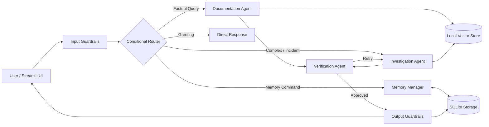

# Asterline Research Assistant That Remembers

> A dependable, inspectable multi-agent research assistant for Asterline Labs that produces grounded answers from company documentation and maintains user-specific memory across sessions.

---

## 1. Project Overview

Asterline Labs is a fictional workflow-monitoring software company. Employees require a research assistant to investigate technical incidents, review operational policies and runbooks, and resume ongoing investigations without re-explaining their workspace context.

This system is built with **LangGraph**, **ChromaDB**, **FastEmbed** local embeddings, and **SQLite**, with end-to-end tracing via **LangSmith**. It strictly enforces the boundary between authoritative company documentation and private user context, supports selective long-term memory with audit logging, and handles document conflicts and temporal supersessions transparently.

---

## 2. Key Architecture Pillars

- **Authoritative Documentary Grounding**: All factual answers are derived from Asterline's 75 corpus chunks (`data/corpus.jsonl`). Every factual claim is verified and cited with its specific `chunk_id` and document `title`.
- **Temporal Supersession & Conflict Resolution**: Automatically identifies when newer policies or patches explicitly supersede older documents (e.g., cold recovery storage updated from 60 days to 20 days; on-call compensation raised from $140 to $175).
- **Separation of Three Data Tiers**:
  1. **Company Knowledge Base**: Immutable, read-only corpus of 75 chunks.
  2. **Conversation History**: Multi-turn session threads stored in SQLite.
  3. **Long-Term Memory**: Curated, isolated user preferences with support for corrections and forget requests.
- **Meaningful Multi-Agent Collaboration**:
  - **Conditional Router**: Directs requests along the minimal necessary execution path.
  - **Documentation Research Agent**: Answers direct factual questions.
  - **Investigation Research Agent**: Synthesizes complex multi-document incidents and reconciles conflicting versions.
  - **Memory Manager Agent**: Manages user memory lifecycle with selective policies and audit logs.
  - **Verification Agent**: Validates factual support, prevents hallucinated citations, and audits privacy.
- **Local Embeddings & Zero-Cost Retrieval**: Uses `BAAI/bge-small-en-v1.5` via FastEmbed for local vector search without external embedding API costs.

---

## 3. Architecture Overview



For complete architectural details, see [docs/architecture.md](docs/architecture.md).

---

## 4. Planned Setup & Launch Guide

*(Note: These setup and launch commands represent the planned execution workflow as defined in Phase 1.)*

### Prerequisites
- Python 3.10+
- Virtual environment tool (`venv` or `uv`)

### 1. Clone & Set Up Environment
```bash
# Clone the repository
git clone https://github.com/<your-username>/asterline-research-assistant.git
cd asterline-research-assistant

# Create and activate virtual environment
python -m venv .venv
# Windows (PowerShell):
.venv\Scripts\Activate.ps1
# Linux / macOS:
source .venv/bin/activate

# Install dependencies (Planned for Phase 2)
pip install -r requirements.txt
```

### 2. Configure Environment Variables
Copy `.env.example` to `.env` and configure your chosen LLM provider and LangSmith credentials:
```bash
cp .env.example .env
```
Key configuration parameters:
- `LLM_PROVIDER`: `groq` (default free/fast Llama-3.3-70B), `openai`, `gemini`, or `anthropic`
- `LLM_API_KEY`: Your model provider API key
- `LANGCHAIN_TRACING_V2`: `true`
- `LANGCHAIN_API_KEY`: Your LangSmith API key
- `LANGCHAIN_PROJECT`: `asterline-research-assistant`

### 3. Initialize & Launch (Planned)
```bash
# 1. Ingest corpus and build local vector index
python -m asterline.rag.ingestion

# 2. Run the Streamlit Application
streamlit run app/main.py
```

---

## 5. Evaluation & Observability Strategy

The project includes an automated evaluation harness under `evaluation/`:
- **Groundedness & Factuality**: Evaluating generated answers against gold-standard citations from the 75 chunks.
- **Temporal Conflict Resolution**: Verifying that questions about superseded policies correctly cite the latest policy and acknowledge the change.
- **Memory Safety & Isolation**: Testing that User A cannot view User B's preferences, and that forget requests completely purge records.
- **LangSmith Tracing**: Every execution run logs the chosen route, agent invocations, retrieval chunks, and verification verdicts for inspection.

---

## 6. Project Roadmap

Please refer to [docs/implementation_plan.md](docs/implementation_plan.md) for detailed progress through the 8 project phases.
- [x] **Phase 1**: Architecture Foundation, System Specification & Scaffolding
- [x] **Phase 2**: Configuration, Typed State Schemas & SQLite Persistence
- [x] **Phase 3**: Local Vector Store & Hybrid Retrieval Engine
- [ ] **Phase 4**: Agent Core, Temporal Resolution & Guardrails
- [ ] **Phase 5**: LangGraph Multi-Agent Orchestration & Routing
- [ ] **Phase 6**: Streamlit UI & Interactive Memory Inspector
- [ ] **Phase 7**: Evaluation Harness & Failure Analysis
- [ ] **Phase 8**: Project Polish & Final AI Disclosure
