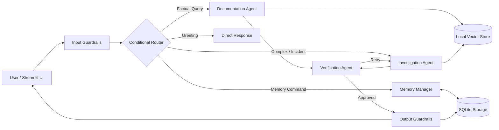

# Asterline Research Assistant That Remembers

> A dependable, inspectable multi-agent research assistant for Asterline Labs that produces grounded answers from company documentation and maintains user-specific memory across sessions.

---

## 1. Project Overview

Asterline Labs is a fictional workflow-monitoring software company. Employees require a research assistant to investigate technical incidents, review operational policies and runbooks, and resume ongoing investigations without re-explaining their workspace context.

This system is built with **LangGraph**, **ChromaDB**, **FastEmbed** local embeddings, and **SQLite**, with end-to-end tracing via **LangSmith**. It strictly enforces the boundary between authoritative company documentation and private user context, supports selective long-term memory with audit logging, and handles document conflicts and temporal supersessions transparently.

---

## 2. Key Architecture Pillars

- **Authoritative Documentary Grounding**: All factual answers are derived from Asterline's 75 corpus chunks (`data/corpus.jsonl`). Every factual claim is verified and cited with its specific `chunk_id` and document `title`.
- **Temporal Supersession & Conflict Resolution**: Automatically identifies when newer policies or patches explicitly supersede older documents (e.g., cold recovery storage updated from 60 days to 20 days; on-call compensation raised from $140 to $175).
- **Separation of Three Data Tiers**:
  1. **Company Knowledge Base**: Immutable, read-only corpus of 75 chunks.
  2. **Conversation History**: Multi-turn session threads stored in SQLite.
  3. **Long-Term Memory**: Curated, isolated user preferences with support for corrections and forget requests.
- **Meaningful Multi-Agent Collaboration**:
  - **Conditional Router**: Directs requests along the minimal necessary execution path.
  - **Documentation Research Agent**: Answers direct factual questions.
  - **Investigation Research Agent**: Synthesizes complex multi-document incidents and reconciles conflicting versions.
  - **Memory Manager Agent**: Manages user memory lifecycle with selective policies and audit logs.
  - **Verification Agent**: Validates factual support, prevents hallucinated citations, and audits privacy.
- **Local Embeddings & Zero-Cost Retrieval**: Uses `BAAI/bge-small-en-v1.5` via FastEmbed for local vector search without external embedding API costs.

---

## 3. Architecture Overview



For complete architectural details, see [docs/architecture.md](docs/architecture.md).

---

## 4. Planned Setup & Launch Guide

*(Note: These setup and launch commands represent the planned execution workflow as defined in Phase 1.)*

### Prerequisites
- Python 3.10+
- Virtual environment tool (`venv` or `uv`)

### 1. Clone & Set Up Environment
```bash
# Clone the repository
git clone https://github.com/<your-username>/asterline-research-assistant.git
cd asterline-research-assistant

# Create and activate virtual environment
python -m venv .venv
# Windows (PowerShell):
.venv\Scripts\Activate.ps1
# Linux / macOS:
source .venv/bin/activate

# Install dependencies (Planned for Phase 2)
pip install -r requirements.txt
```

### 2. Configure Environment Variables
Copy `.env.example` to `.env` and configure your chosen LLM provider and LangSmith credentials:
```bash
cp .env.example .env
```
Key configuration parameters:
- `LLM_PROVIDER`: `groq` (default free/fast Llama-3.3-70B), `openai`, `gemini`, or `anthropic`
- `LLM_API_KEY`: Your model provider API key
- `LANGCHAIN_TRACING_V2`: `true`
- `LANGCHAIN_API_KEY`: Your LangSmith API key
- `LANGCHAIN_PROJECT`: `asterline-research-assistant`

### 3. The Four Core Agents & Responsibilities

The system orchestrates four specialized agents to balance factual precision with workspace personalization:
1. **Documentation Research Agent** ([`src/asterline/agents/documentation.py`](src/asterline/agents/documentation.py)):
   - Focuses on direct, single-topic factual questions (pricing plans, API limits, query syntax).
   - Generates grounded drafts citing exact chunk identifiers and document titles.
   - Explicitly abstains with empty citations when documentation is absent.
2. **Investigation Research Agent** ([`src/asterline/agents/investigation.py`](src/asterline/agents/investigation.py)):
   - Synthesizes complex multi-document incidents (e.g., `INC-2025-08`, `INC-2025-12`).
   - Automatically identifies and resolves temporal policy supersessions (newer published chunks override older deprecated policies).
   - Cross-examines version evolution across product releases.
3. **Memory Manager Agent** ([`src/asterline/agents/memory_manager.py`](src/asterline/agents/memory_manager.py)):
   - Extracts and sanitizes durable user context (deployment environments, tooling preferences, project roles).
   - Enforces strict safety policies: rejects API keys, passwords, and product-wide company assertions.
   - Manages permanent cryptographic/physical purging upon forget requests.
4. **Verification Agent** ([`src/asterline/agents/verification.py`](src/asterline/agents/verification.py)):
   - Acts as an independent fact-checker auditing draft answers against retrieved evidence.
   - Flags fabricated chunk IDs or ungrounded claims and commands bounded revision retries (max 2).
   - Audits privacy to prevent cross-user memory leakage.

---

## 4. Setup, Installation & Launch Guide

### Prerequisites
- Python 3.10+
- `pip` package manager

### 1. Installation
```bash
# Clone the repository
git clone https://github.com/<your-username>/asterline-research-assistant.git
cd asterline-research-assistant

# Install project dependencies
pip install -e .
pip install -e ".[test]"
```

### 2. Environment Configuration
Copy `.env.example` to `.env`:
```bash
cp .env.example .env
```
Key configuration parameters:
- `LLM_PROVIDER`: `groq` (default fast Llama-3.3-70B), `openai`, `gemini`, or `anthropic`
- `LLM_API_KEY`: Your model provider API key (optional; defaults to deterministic offline synthesis)
- `LANGCHAIN_TRACING_V2`: `true` (optional; defaults to `false`)
- `LANGCHAIN_API_KEY`: Your LangSmith API key
- `LANGCHAIN_PROJECT`: `asterline-research-assistant`

---

## 5. Execution Commands

### 1. Launch Interactive Streamlit UI
```bash
streamlit run app/main.py
```
*Opens the modern dark-mode research workspace at `http://localhost:8501`. Includes multi-user demonstration switching (Alice, Bob, Charlie), persistent conversation threads, expandable citations, full Memory Inspector, and live agent trace panels.*

### 2. Run Reproducible Offline Evaluations
```bash
python -m evaluation.run_evals
```
*Evaluates 50 test cases across retrieval (Hit Rate, Recall, MRR), citation validity (100%), grounding (100%), abstention (100%), temporal supersession (100%), routing (100%), and memory isolation/purges (100%). Zero paid API calls required.*

### 3. Run Automated Test Suite
```bash
python -m pytest
```
*Runs all 116 unit, integration, and regression tests across agents, memory, retrieval, workflow, evaluation, and Streamlit UI.*

---

## 6. Demonstration Profiles & Limitations

The sidebar provides an instant profile switcher between:
- **Alice** (`user_alice`): DevOps Lead (Focus: Pipelines, BigQuery/Snowflake warehouse exports, deployments)
- **Bob** (`user_bob`): Backend Platform Engineer (Focus: AQL queries, ingestion endpoints, SDK batching)
- **Charlie** (`user_charlie`): Customer Support & QA (Focus: Enterprise SLAs, incident timelines, Signals alert rules)

> [!IMPORTANT]
> **Demonstration Identity Notice**: The user profile selector is a demonstration identity simulation mechanism, not production authentication (e.g. OAuth2/SAML). However, all underlying SQLite operations, conversation threads, and memory records are **strictly partitioned and isolated** by `user_id`. Alice, Bob, and Charlie can never access, mutate, or purge each other's data.

---

## 7. Evaluation & Observability Summary

- **Evaluation Benchmark**: Full formulas, datasets, and actual metric outputs are documented in [docs/evaluation.md](docs/evaluation.md).
- **Failure Analysis**: Technical retrospective of observed failure modes (nearest-neighbor trap, regex boundary clipping, soft-delete retention) and fixes is in [docs/failure_analysis.md](docs/failure_analysis.md).
- **LangSmith Tracing**: Implemented in [`src/asterline/observability/tracing.py`](src/asterline/observability/tracing.py). Automatically redacts secrets, credentials, and passwords before dispatch, and protects personal memory from trace tags and metadata. Operates in non-blocking offline mode when credentials are absent.

---

## 8. Project Roadmap

Please refer to [docs/implementation_plan.md](docs/implementation_plan.md) for detailed progress through all project phases.
- [x] **Phase 1**: Architecture Foundation, System Specification & Scaffolding
- [x] **Phase 2**: Configuration, Typed State Schemas & SQLite Persistence
- [x] **Phase 3**: Local Vector Store & Hybrid Retrieval Engine
- [x] **Phase 4**: Agent Core, Temporal Resolution & Guardrails
- [x] **Phase 5**: Evaluation Harness, LangSmith Observability & System Hardening
- [x] **Phase 6**: Interactive Streamlit UI & Multi-User Simulation *(116 tests passing, smoke-tested)*
- [ ] **Phase 7**: AI Disclosure, Submission Packaging & Final Polish
