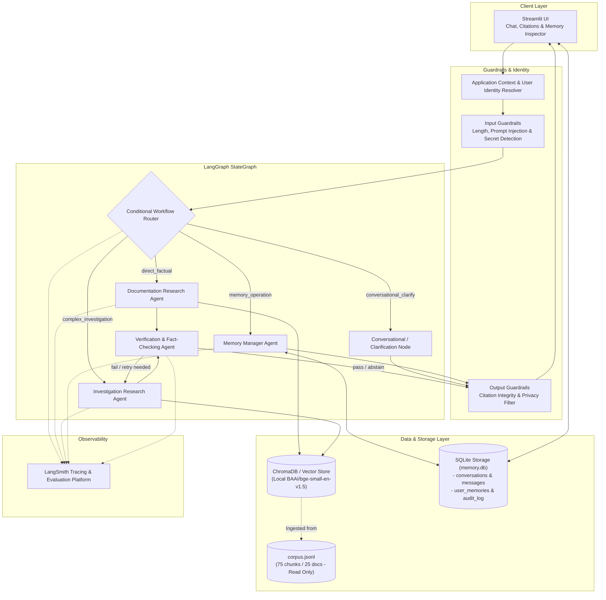
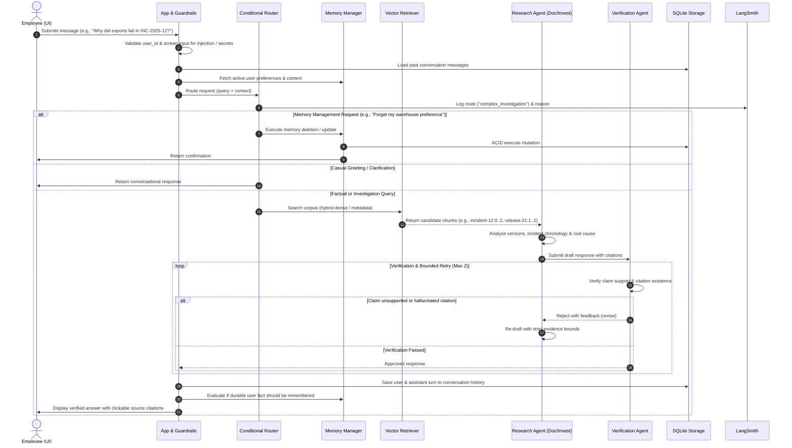

# Asterline Labs: Research Assistant That Remembers
## System Architecture & Technical Design Specification

### 1. Problem Statement & Goals

Asterline Labs is a fictional workflow-monitoring software company. Its knowledge base consists of 25 documents split into 75 distinct chunks covering product specifications, pricing, policies, release notes, architecture specifications, and post-mortem incident reports. 

Employees must query this knowledge base to answer operational questions, investigate complex outages and regressions, and resume multi-turn investigations across days or weeks without repeating their workspace context or team preferences.

#### Core Challenges
1. **Document Grounding & Factuality**: LLMs hallucinate or draw from pre-training biases. Answers must be strictly grounded in Asterline's 75 corpus chunks with verifiable source citations (`chunk_id` and document `title`).
2. **Temporal Supersession & Document Conflicts**: Policies and specifications change across versions (e.g., cold recovery storage updated from 60 days to 20 days; on-call stipends raised from $140 to $175; AQL timeouts extended from 25s to 50s). The system must recognize explicit supersession and document specificity rather than using simplistic recency heuristics.
3. **Strict Boundary between Evidence and User Memory**: User statements (e.g., "my workspace retains records for 90 days") represent private workspace context or personal notes, *never* authoritative company-wide documentation.
4. **Selective, Isolated, and Auditable Long-Term Memory**: The assistant must store only durable, relevant user facts (role, active projects, preferred cloud warehouse), reject transient chitchat or credentials, maintain complete user-level isolation, and reliably execute memory corrections and "forget" requests.
5. **Inspectability & Observability**: Every agent decision, retrieval query, verification check, and memory mutation must be traceable via LangSmith and structured execution logs.

---

### 2. Functional & Non-Functional Requirements

#### Functional Requirements
- **FR-1: Grounded Q&A**: Direct factual lookups (pricing, limits, SLA terms, API schemas) cited down to specific `chunk_id` and document `title`.
- **FR-2: Multi-Document Investigation**: Cross-referencing multiple chunks for incident timelines, root causes, version changelogs, and policy interactions.
- **FR-3: Conflict & Uncertainty Handling**: Explicit detection of conflicting versions; acknowledging missing evidence or unresolvable ambiguities rather than guessing.
- **FR-4: Session & Conversation Continuity**: Chat history persists in SQLite across application restarts; past messages provide context for follow-up questions.
- **FR-5: Selective Long-Term Memory**: Auto-extraction of stable user facts, manual memory management (view, update, delete), and strict rejection of sensitive tokens/keys.
- **FR-6: Privacy & User Isolation**: Stored memories and conversation threads are keyed strictly by trusted `user_id`. One user can never access or leak another user's context.
- **FR-7: Interactive User Interface**: Streamlit UI offering multi-turn chat, trusted user identity switching (simulation), source citation inspection, and long-term memory management.

#### Non-Functional Requirements
- **NFR-1: Local Vector Store & Local Embeddings**: Zero external API dependencies for embedding generation and vector search (FastEmbed `bge-small-en-v1.5` + ChromaDB / In-Memory Vector Store).
- **NFR-2: Configurable LLM Provider**: Pluggable support for Groq (Llama-3.3-70B), OpenAI, Anthropic, or Google Gemini via a unified configuration layer without altering agent code.
- **NFR-3: Bounded Execution & Latency**: Deterministic guardrails and bounded agent retries (maximum 2 retries on verification failure) to prevent infinite loops.
- **NFR-4: ACID Persistence**: SQLite database for conversations, messages, and memories with foreign key constraints and transactional integrity.
- **NFR-5: LangSmith Observability**: End-to-end tracing capturing agent nodes, retrieval inputs/outputs, route selections, and verification verdicts without exposing private secrets.

---

### 3. System Component Architecture



---

### 4. Agent Responsibility Matrix

The architecture defines **four distinct agents** and **one workflow router node**:

| Agent / Node | Primary Responsibility | Input Contract | Output Contract | Tools & Data Access |
| :--- | :--- | :--- | :--- | :--- |
| **Conditional Router** *(Workflow Node)* | Inspects incoming query + conversation history to choose the minimal necessary execution path. | `user_message`, `conversation_history`, `user_profile` | `route` (`factual`, `investigation`, `memory_ops`, `conversational`, `clarification`), `routing_reason` | None (Deterministic rules + lightweight intent classifier) |
| **Documentation Research Agent** | Answers focused, direct factual questions (specs, pricing, limits, SLAs, policies). Cites specific chunk IDs. | `query`, `retrieved_chunks`, `user_context` | `draft_answer`, `cited_chunk_ids`, `confidence` | Local Vector Retriever (Top-K = 4) |
| **Investigation Research Agent** | Resolves complex, multi-chunk questions (incidents, version migrations, temporal supersessions, contradictions). Synthesizes timelines. | `query`, `retrieved_chunks`, `historical_context` | `investigation_report`, `evidence_chain`, `resolved_conflicts`, `cited_chunk_ids` | Local Vector Retriever (Top-K = 8), Temporal Resolution Engine |
| **Memory Manager Agent** | Handles user context lifecycle: retrieval of relevant personal preferences, extraction of candidate durable facts, updates, and hard deletion ("forget"). | `user_id`, `action` (`get`, `store`, `update`, `forget`), `content`, `memory_id` | `memories_list`, `operation_status`, `confirmation_message` | SQLite Memory Service (`user_memories` table) |
| **Verification Agent** | Audits draft responses for factual fidelity against retrieved chunks, validates citations, enforces privacy, and detects ungrounded claims. | `draft_answer`, `cited_chunk_ids`, `retrieved_chunks`, `user_id` | `verdict` (`pass`, `revise`, `abstain`), `unsupported_claims`, `citation_errors`, `feedback` | Citation Validator, Grounding Checker, Privacy Auditor |

---

### 5. Detailed End-to-End Workflow & Conditional Routing

The system executes through 13 discrete stages:



#### Routing Logic Specification
1. **Deterministic Filter**:
   - Explicit memory commands (`"remember that..."`, `"forget my..."`, `"what do you know about me"`) $\rightarrow$ `memory_operation`.
   - Simple greetings (`"hi"`, `"hello"`, `"who are you"`) $\rightarrow$ `conversational_direct`.
   - Vague / underspecified queries $\rightarrow$ `clarification`.
2. **Classifier (Lightweight LLM / Pattern Rules)**:
   - Queries with keywords matching incidents (`INC-`), multi-version comparisons, rollouts, or conflicting policies $\rightarrow$ `investigation`.
   - Single-topic lookups (pricing tier, AQL syntax, rate limit, SLA percentage) $\rightarrow$ `factual`.

---

### 6. The Three Data Categories & Separation Boundaries

To ensure complete reliability, three information categories are kept architecturally and physically distinct:

```
+---------------------------------------------------------------------------------------+
|                                    APPLICATION STATE                                  |
+---------------------------------------------------------------------------------------+
|                                                                                       |
|  [1. COMPANY KNOWLEDGE]         [2. CONVERSATION HISTORY]     [3. LONG-TERM MEMORY]   |
|  - Read-Only Corpus (75 chunks) - Ephemeral / Multi-turn      - Durable User Context  |
|  - Vector Store (ChromaDB)      - SQLite (conversations table)- SQLite (memories tbl) |
|  - Authoritative company ground - Per-session thread continuity- Personal preferences  |
|  - Common to all users          - Isolated per user_id        - Isolated per user_id  |
|                                                                                       |
+---------------------------------------------------------------------------------------+
```

#### Boundary Rules
1. **Evidence Asymmetry**:
   - Authoritative company documentation is the **ONLY** source of truth for company facts, limits, pricing, technical specs, and incident post-mortems.
   - Long-term user memory provides **personal context** (e.g., "User Harsh is working on project `eu-telemetry-01` on Team tier"), but can **never** override company documentation.
   - Example: If a user memory states *"Asterline offers unlimited retention on Launch"*, this statement must be dismissed as false during company research because `pricing:1` establishes Launch retention as 21 days.
2. **User Isolation**:
   - Every row in `conversations`, `messages`, and `user_memories` includes a non-nullable `user_id`.
   - All queries filter strictly by `WHERE user_id = :current_user_id`.
   - Cross-user memory inspection is physically impossible at the repository layer.
3. **Selective Long-Term Memory Policy**:
   - **Allowed**: User role, team, cloud provider in use (BigQuery/Snowflake/Redshift), workspace tier, regional deployment preference.
   - **Forbidden / Rejected**: API keys, passwords, bearer tokens, PII/health data, transient emotions, casual remarks, factual claims about Asterline products.

---

### 7. Evidence Evaluation & Conflict-Resolution Policy

The 75 chunks contain deliberate historical versions and policy evolutions. The system implements a 4-tier conflict resolution hierarchy:

#### Conflict Resolution Hierarchy
```
Tier 1: Explicit Supersession Statement (Highest Priority)
Tier 2: Specificity & Context Scope (e.g., specific policy vs. general overview)
Tier 3: Document Effective Date / Publication Date (Newer overrides older IF scope matches)
Tier 4: Genuine Unresolvable Conflict -> Explicitly Disclose to User (Abstain/Clarify)
```

#### Real Examples from Asterline Corpus

| Scenario | Chunk A (Older / General) | Chunk B (Newer / Specific) | Correct Resolution & Policy Applied |
| :--- | :--- | :--- | :--- |
| **Cold Recovery Retention** | `security:1` (Published 20250315): *"raw run records remain in cold recovery storage for 60 days"* | `retention:0` (Published 20260115, v2): *"Effective 2026-01-15, raw run records are held in cold recovery storage for 20 days... This policy supersedes the earlier 60-day cold-storage period."* | **Tier 1 (Explicit Supersession)**: Cite `retention:0` as current (20 days) and mention that `security:1` was superseded effective Jan 15, 2026. |
| **On-call Weekly Stipend** | `oncall:0` (Published 20250410, v1): *"lists an on-call stipend of $140 per week."* | `handbook:1` (Published 20260105, v3): *"Effective 2026-01-01 the weekly on-call stipend is $175, replacing $140. This compensation update supersedes stipend figures in older operational runbooks."* | **Tier 1 (Explicit Supersession)**: Stipend is $175/week. Reference both chunks to explain the update. |
| **AQL Query Timeout** | `release-20:2` / `release-22:2`: *"25-second AQL query timeout"* | `release-23:0` / `query:0` (Published 20260310, v2.3): *"increased the AQL timeout from 25 to 50 seconds."* | **Tier 3 (Version Supersession)**: Current timeout is 50 seconds in v2.3; historical timeout was 25 seconds. |
| **Warehouse Deduplication Failure** | `incident-12:0..2`: INC-2025-12 duplicate rows caused by Heron query engine ordering. | `release-21:2`: Patch 2.1.2 fixed deduplication by using `(export_job_id, record_hash)`. | **Investigation Synthesis**: Relate the incident to Heron engine rollout and explain the patch fix and idempotency key change. |
| **Company Overview vs. Limits** | `company:2`: *"This overview is introductory, not a source for commercial limits... Use dated pricing..."* | `pricing:0..2`: Detailed seat counts, overage rates, and retention. | **Tier 2 (Specificity & Scope)**: Introductory overview Chunk 2 explicitly defers to pricing documents. |

---

### 8. Database Schema & State Persistence Specifications

SQLite database (`data/memory.db`) schema:

```sql
-- Conversations Table (Tracks interactive sessions)
CREATE TABLE IF NOT EXISTS conversations (
    conversation_id TEXT PRIMARY KEY,
    user_id TEXT NOT NULL,
    title TEXT NOT NULL,
    created_at TIMESTAMP DEFAULT CURRENT_TIMESTAMP,
    updated_at TIMESTAMP DEFAULT CURRENT_TIMESTAMP
);
CREATE INDEX IF NOT EXISTS idx_conversations_user ON conversations(user_id);

-- Messages Table (Conversation turns)
CREATE TABLE IF NOT EXISTS messages (
    message_id TEXT PRIMARY KEY,
    conversation_id TEXT NOT NULL,
    user_id TEXT NOT NULL,
    role TEXT NOT NULL CHECK(role IN ('user', 'assistant', 'system')),
    content TEXT NOT NULL,
    citations_json TEXT, -- JSON array of {chunk_id, title}
    route_taken TEXT,
    created_at TIMESTAMP DEFAULT CURRENT_TIMESTAMP,
    FOREIGN KEY(conversation_id) REFERENCES conversations(conversation_id) ON DELETE CASCADE
);
CREATE INDEX IF NOT EXISTS idx_messages_conversation ON messages(conversation_id);

-- Long-Term User Memories (Curated durable knowledge)
CREATE TABLE IF NOT EXISTS user_memories (
    memory_id TEXT PRIMARY KEY,
    user_id TEXT NOT NULL,
    category TEXT NOT NULL CHECK(category IN ('preference', 'workspace_context', 'project_role', 'investigation_note')),
    content TEXT NOT NULL,
    confidence REAL DEFAULT 1.0,
    source_message_id TEXT,
    is_active INTEGER DEFAULT 1,
    created_at TIMESTAMP DEFAULT CURRENT_TIMESTAMP,
    updated_at TIMESTAMP DEFAULT CURRENT_TIMESTAMP
);
CREATE INDEX IF NOT EXISTS idx_user_memories_user ON user_memories(user_id, is_active);

-- Memory Audit Log (Immutable record of additions, modifications, and deletions)
CREATE TABLE IF NOT EXISTS memory_audit_log (
    audit_id TEXT PRIMARY KEY,
    memory_id TEXT NOT NULL,
    user_id TEXT NOT NULL,
    action TEXT NOT NULL CHECK(action IN ('CREATE', 'UPDATE', 'DELETE', 'PURGE')),
    previous_content TEXT,
    new_content TEXT,
    reason TEXT,
    timestamp TIMESTAMP DEFAULT CURRENT_TIMESTAMP
);
```

---

### 9. LangGraph State Schema & Inter-Agent Contracts

The shared workflow state passed through the LangGraph execution pipeline is strictly typed:

```python
from typing import TypedDict, List, Dict, Optional, Any

class Citation(TypedDict):
    chunk_id: str
    doc_id: str
    title: str
    source_url: str

class RetrievedChunk(TypedDict):
    chunk_id: str
    doc_id: str
    title: str
    category: str
    owner: str
    source_url: str
    published: str
    version: str
    text: str
    relevance_score: float

class VerificationResult(TypedDict):
    verdict: str  # "pass", "revise", "abstain"
    is_grounded: bool
    citation_validity: bool
    privacy_compliant: bool
    feedback: Optional[str]
    unsupported_claims: List[str]

class ResearchAssistantState(TypedDict):
    # Session Context
    conversation_id: str
    user_id: str
    user_message: str
    
    # Context Loaded from Storage
    conversation_history: List[Dict[str, str]]
    active_user_memories: List[Dict[str, Any]]
    
    # Workflow & Routing
    route: str  # "factual", "investigation", "memory_ops", "conversational", "clarification"
    routing_reason: str
    retry_count: int
    
    # Research Artifacts
    search_queries: List[str]
    retrieved_chunks: List[RetrievedChunk]
    draft_response: str
    citations: List[Citation]
    
    # Verification & Finalization
    verification: Optional[VerificationResult]
    final_response: str
    memory_operations_executed: List[str]
```

---

### 10. Guardrails, Safety, and Privacy Boundaries

1. **Input Guardrails**:
   - **Length check**: Reject or truncate inputs $> 4,000$ characters.
   - **Ingestion Key Redaction**: Regex filter detecting Asterline ingestion keys (`ast_[a-zA-Z0-9]{24,}`) or generic API keys, preventing them from being stored in memory or traces.
   - **Prompt Injection Defense**: Explicit delimiters wrapping user context and retrieved documents to prevent instruction overriding.
2. **Output Guardrails**:
   - **Citation Existence Verification**: Every cited `chunk_id` in the final answer is cross-checked against the `retrieved_chunks` list. Invented chunk IDs trigger immediate revision or stripping.
   - **Privacy Isolation Filter**: Scans output to ensure no entity or memory belonging to a different `user_id` is present.
   - **Uncertainty Enforcement**: When evidence is partial or absent, the model is constrained to explicitly acknowledge what is not documented.

---

### 11. Error Handling, Retry Limits, and Failure Modes

| Failure Scenario | Mitigation / Recovery Strategy | Fallback Behavior |
| :--- | :--- | :--- |
| **LLM Provider Outage or Rate Limit (HTTP 429/500)** | Exponential backoff (1s, 2s, 4s). Supported alternative provider failover. | Graceful error message: *"The research model is temporarily unavailable. Please retry shortly."* No state corruption. |
| **Verification Rejection (Unsupported claim or hallucinated citation)** | Up to `MAX_INVESTIGATION_RETRIES = 2`. The agent is invoked with the specific verifier feedback. | If retry budget exhausted, fallback to an honest **Abstain** message with available raw evidence excerpts. |
| **Empty Vector Search Results** | Relaxed keyword fallback search. | Clear disclosure: *"No relevant company documentation found in Asterline KB."* |
| **Corrupted Memory Database** | SQLite transactions with `BEGIN IMMEDIATE` and rollback on error. | Memory operation aborted with explicit error; past confirmed state retained. |

---

### 12. Technology Choices & Trade-off Analysis

| Component | Choice | Alternative Considered | Rationale & Trade-off |
| :--- | :--- | :--- | :--- |
| **Agent Framework** | **LangGraph** | Autogen, CrewAI | LangGraph provides explicit cyclical graph control, typed state transitions, checkpointing, and native LangSmith tracing. |
| **Embeddings** | **FastEmbed (`bge-small-en-v1.5`)** | OpenAI `text-embedding-3-small` | Satisfies strict constraint for local embeddings; zero API costs, runs on CPU in $<50$ms per query. |
| **Vector Store** | **ChromaDB / Local In-Memory** | FAISS, Pinecone | ChromaDB runs embedded in-process, supports metadata filtering on `category`, `published`, `version`, and requires no separate server. |
| **App Persistence** | **SQLite** | PostgreSQL, Redis | Zero operational overhead, ACID compliance, single-file reproducibility for evaluation and demonstrations. |
| **Observability** | **LangSmith** | WandB, Phoenix | Native first-class integration with LangGraph; full node-level and tool-level latency, tokens, and trace visualization. |
| **UI** | **Streamlit** | Gradio, Next.js | Rapid Python-native prototyping, allows live user-switching simulation and memory inspection tabs. |

---

### 13. Known Assumptions & Limitations

1. **Synthetic User Identity**: Authentication is simulated via an application-level user selector. In production, this would be wired to an OIDC / SAML SSO identity provider.
2. **Static Knowledge Base**: The 75-chunk corpus is treated as an immutable snapshot. Dynamic corpus updates are out of scope for this assignment.
3. **Local Embedding Dimension**: `bge-small-en-v1.5` outputs 384-dimensional dense vectors. It is highly optimized for semantic search on technical docs but may require hybrid BM25 re-ranking for exact error code matches (`INC-2025-08`).
